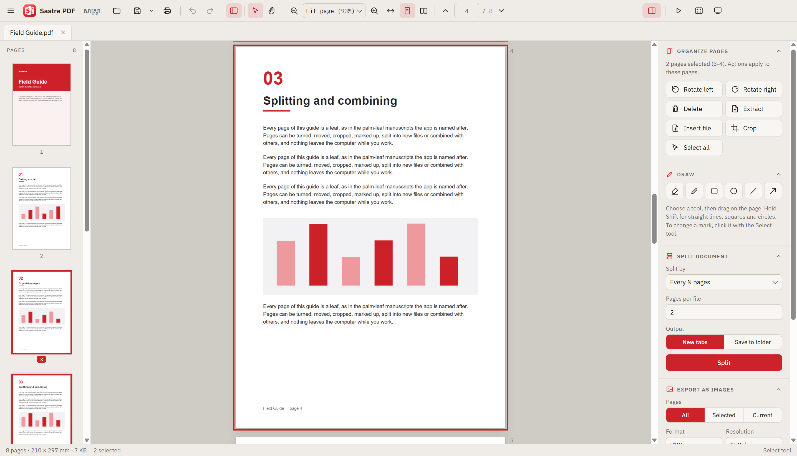

<div align="center">


# Sastra PDF <sup>សាស្ត្រា</sup>

**A fast, private PDF workbench for Windows.**
Organize, combine, split, crop, mark up, print and export PDF pages, all on your own computer.

<a href="https://apps.microsoft.com/detail/9P768LL4RTVP?mode=direct">
  
</a>

[](LICENSE)


</div>

<picture>
  <source media="(prefers-color-scheme: dark)" srcset="docs/images/screenshot-dark.png">
  
</picture>

## About

Sastra PDF brings the everyday page tools of a professional PDF editor to a clean, native Windows app.
Open several PDFs as tabs, drag pages between them, and save — nothing is uploaded anywhere.

The name comes from **សាស្ត្រា** (*sastra*), the traditional Khmer palm-leaf manuscripts, where every leaf is a page.

## Features

**Organize pages**
- Open many PDFs at once, each in its own tab
- Page thumbnails: select, reorder by dragging, or drag pages into another file to copy them
- Rotate, delete, extract and insert pages, with full Undo / Redo
- Drop PDFs or pictures straight into the page list to insert them where you let go

**Combine and split**
- Combine PDFs and pictures (JPG, PNG, BMP, GIF, WebP) into one file
- Split every N pages, by page ranges, or one file per page — into new tabs or a folder

**Crop and mark up**
- Crop pages by dragging a box or typing margins, on one page or many; remove white margins in one click
- Highlight, pen, rectangle, circle, line and arrow, with colour, fill and border
- Marks are saved as standard PDF annotations, so they show in Acrobat and other readers and stay editable

**Print, export and shrink**
- Full print screen with live preview: page ranges, scaling, poster, several pages per sheet, booklet, both sides
- Export pages as PNG or JPG at 72, 150 or 300 dpi
- Save as Reduced Size PDF to make large, picture-heavy files much smaller

**Feels at home on Windows**
- Hand tool, zoom, fit width / fit page, two-page view, Present mode and a distraction-free Maximize view
- Light and dark themes that follow Windows
- File Explorer right-click menu: Make PDF, Combine, Split, Images and Reduce file size without opening the app
- Sharp, ClearType text on screen and high-resolution printing
- Khmer file names and text fully supported

## Download

Sastra PDF is available free from the **[Microsoft Store](https://apps.microsoft.com/detail/9P768LL4RTVP)**
for Windows 10 and Windows 11 (64-bit). The Store version is signed by Microsoft and updates itself.

> Copies installed from an installer (version 1.2.0 and earlier) keep working but no longer update.
> Install the Store version, then uninstall the old one.

## Privacy

Sastra PDF sends nothing about you or your files anywhere. Your PDFs stay on your computer, there is no telemetry,
and every font ships inside the app. The only network request is the update check: the Store version asks the
Microsoft Store, through Windows, whether a newer version exists (at start and every 6 hours).

## Build from source

**Requirements**
- Windows 10 or 11
- [Node.js](https://nodejs.org) 22.13 or newer
- [pnpm](https://pnpm.io) — `npm install -g pnpm`
- For the File Explorer menu: Visual Studio Build Tools with *Desktop development with C++* (x64) and the Windows SDK

**Run it**

```bat
pnpm install
pnpm start
```

Or double-click `run.bat`.

**Build an installer**

```bat
pnpm run dist
```

The installer is written to `dist\`. For a single portable `.exe`, run `pnpm run dist:portable`;
for the Microsoft Store package, `pnpm run dist:store`. Double-clicking `build.bat` does the install and build in one step.

<details>
<summary><b>Project layout</b></summary>

| Path | What it is |
| --- | --- |
| `main.js`, `preload.js` | Electron main process (window, menus, file dialogs, printing) and the safe bridge to the page |
| `app/index.html` | The app interface and PDF tools |
| `app/print.js`, `app/crop.js`, `app/draw.js`, `app/marks.js`, `app/reduce.js` | Printing, cropping, drawing, PDF annotations, file-size reduction |
| `app/task.html`, `app/task.js` | The small progress window for File Explorer menu jobs |
| `explorer-menu/` | The File Explorer right-click menu (C++) and its Windows 11 package |
| `store-update/` | Helpers the Store version uses to check for and install updates |
| `build/` | Icons, installer steps and the Store package configuration |
| `scripts/` | Install and build helpers |

</details>

<details>
<summary><b>Troubleshooting</b></summary>

- **"Cannot create symbolic link" during `pnpm run dist`** — run `build.bat` once as Administrator, or turn on
  *Settings › System › For developers › Developer Mode*.
- **SmartScreen warns about a self-built installer** — it isn't code-signed. Choose *More info › Run anyway*.
- **Behind a proxy** — run `pnpm config set --global https-proxy http://host:port` before building.

</details>

## Built with

[Electron](https://www.electronjs.org) · [PDF.js](https://mozilla.github.io/pdf.js/) · [pdf-lib](https://pdf-lib.js.org) ·
[IBM Plex](https://www.ibm.com/plex/) · [Noto Sans Khmer](https://fonts.google.com/noto/specimen/Noto+Sans+Khmer)

The full list of open-source parts and their licences is on the app's About screen.

## Licence

Sastra PDF is released under the [MIT Licence](LICENSE).
Copyright © 2026 Sunnguon Taing ([smith89k](https://github.com/smith89k)).

The open-source parts it ships keep their own licences, all permissive or font licences: PDF.js (Apache-2.0),
pdf-lib (MIT), pako (MIT and Zlib), Electron (MIT), electron-updater (MIT), IBM Plex and Noto Sans Khmer (SIL OFL 1.1).
